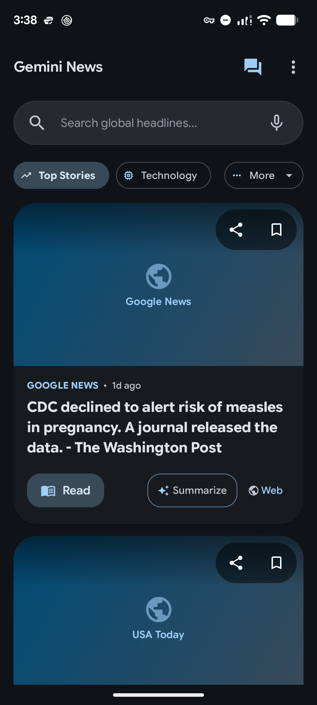
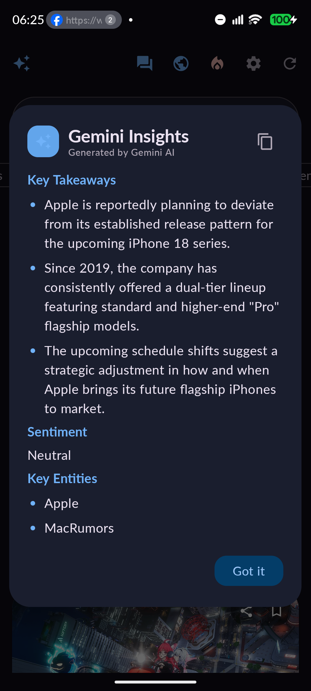
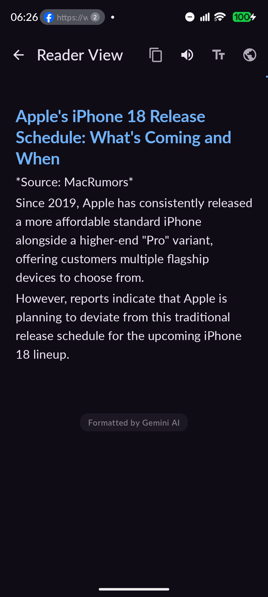
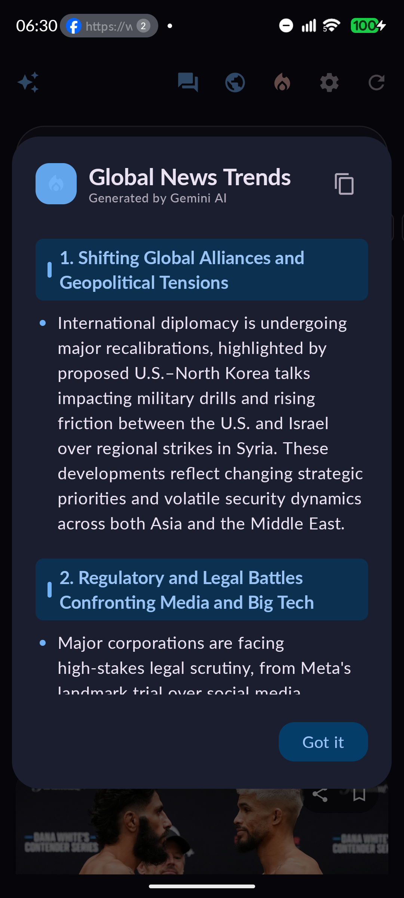
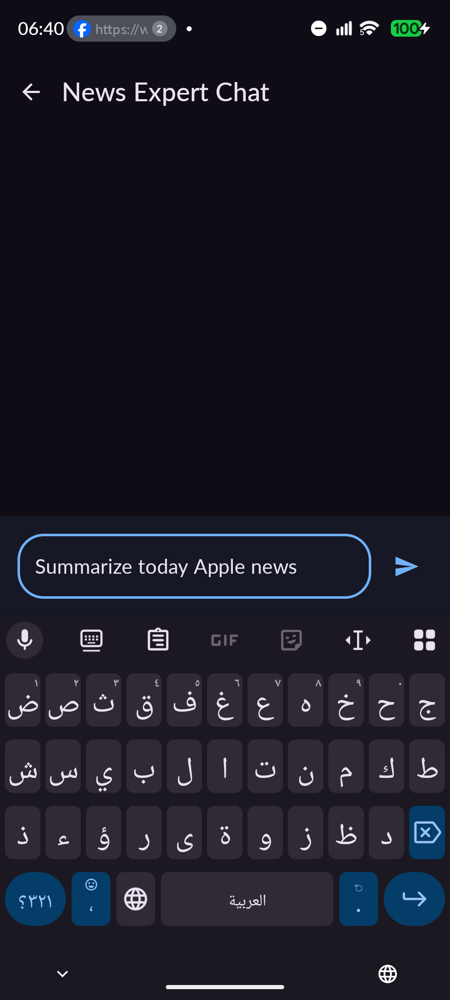
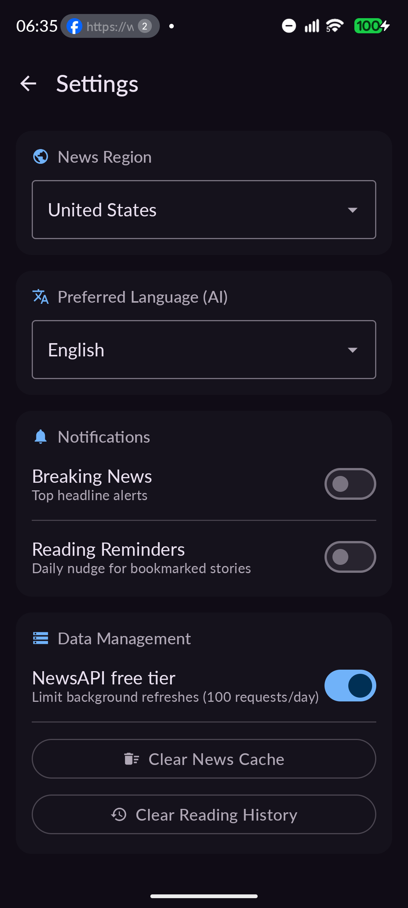

# ⚡ Gemini News — AI-Powered Android News Platform

<p align="center">
  
</p>

<p align="center">
  <strong>An intelligent, adaptive news ecosystem powered by Google Gemini AI and modern Android architecture.</strong>
</p>

<p align="center">
  
  
  
  
  
  
  
  
</p>

> [!WARNING]
> **Android app status: In Development (Pre-Release / Developer Preview)**
> The app binary is not ready for consumer distribution or Google Play publication. This warning is about releasing the Android app; the source repository can be published on GitHub. See [Production Notes](docs/PRODUCTION_NOTES.md) for app release requirements.

---

## 🌟 Overview

**Gemini News** is a next-generation Android news reader that combines real-time global news aggregation with **Google Gemini AI**. Instead of presenting endless walls of unfiltered articles, Gemini News synthesizes, contextualizes, and delivers distraction-free reporting tailored to your reading preferences.

Built with **100% Jetpack Compose**, **Material 3 Adaptive Design**, **Firebase Vertex AI**, and a resilient **Offline-First Room Architecture**, the app delivers desktop-grade fluidity on phones, foldables, and tablets.

---

## 📱 Screenshots Showcase

<div align="center">
  <table>
    <tr>
      <td align="center" width="33%">
        <br />
        <b>📰 Top Stories & Categories</b><br />
        <i>Modern card feeds with quick reader & summary actions</i>
      </td>
      <td align="center" width="33%">
        <br />
        <b>✨ Gemini Insights</b><br />
        <i>Structured takeaways, sentiment pills & key entities</i>
      </td>
      <td align="center" width="33%">
        <br />
        <b>📖 AI Reader View</b><br />
        <i>Distraction-free Markdown reader with Text-to-Speech</i>
      </td>
    </tr>
    <tr>
      <td align="center" width="33%">
        <br />
        <b>🔥 Global News Trends</b><br />
        <i>Macro-narrative synthesis across global events</i>
      </td>
      <td align="center" width="33%">
        <br />
        <b>💬 News Expert Chat</b><br />
        <i>Conversational AI briefed on today's headlines</i>
      </td>
      <td align="center" width="33%">
        <br />
        <b>⚙️ Settings & Privacy</b><br />
        <i>US headlines, AI language, and quota management</i>
      </td>
    </tr>
  </table>
</div>

---

## 🚀 Core Capabilities

### 🧠 Gemini AI Intelligence
- **Gemini Insights (Smart Summaries)**: One-tap analysis generating structured **Key Takeaways**, **Sentiment & Tone** badges, and **Key Entities**.
- **Distraction-Free AI Reader Mode**: Reformats the NewsAPI title/description/content into clean Markdown with custom font scaling and typography. This does **not** download publisher HTML or bypass paywalls.
- **Global News Trends**: Synthesizes cross-outlet reporting into the top macro-narratives shaping the world right now.
- **AI News Map**: Extracts geographic locations mentioned in headlines and renders them on an interactive Google Maps globe.
- **Conversational News Expert**: Chat directly with Gemini about breaking news, background context, or historical parallels.
- **Personalized "For You" Feed**: Semantic recommendations derived from your on-device reading history and saved bookmarks.
- **Weekly News Digest & Personality**: Analyzes your reading habits to deliver creative summaries and personal news archetypes.

### 🎨 Material 3 & Fluid UX
- **Adaptive Layout**: Native `ListDetailPaneScaffold` supporting single-column phones, dual-pane foldables, and wide-screen tablets.
- **Text-to-Speech (Read Aloud)**: High-quality audio playback with auto-scrolling and background utterance handling.
- **One-Tap Card Navigation**: Interactive cards with smooth ripple animations and direct access to Reader Mode.
- **Voice Search**: Built-in speech recognition for natural news discovery.
- **Dynamic Theming**: True AMOLED dark mode, Material You dynamic color, and rich custom markdown badges.

---

## 🏗️ Architecture & Engineering

```
com.aus.gemini01/
├── data/
│   ├── ai/                      # AI abstraction & error taxonomy
│   │   ├── AiRepository.kt      # Deduplication, caching, model dispatch
│   │   ├── AiResult.kt          # Sealed success/failure result models
│   │   ├── AiError.kt           # Quota, network, timeout, key error taxonomy
│   │   ├── AiTelemetry.kt       # DataStore usage & diagnostics tracking
│   │   └── AiCacheKeys.kt       # SHA-256 feature-specific cache hashing
│   ├── local/                   # Room persistence layer
│   │   ├── AppDatabase.kt       # Migrations & database definition
│   │   ├── NewsDao.kt           # Bookmarks, history, and cached feeds
│   │   └── AiResultDao.kt       # Room persistent AI response caching
│   ├── NewsRepository.kt        # Retrofit network repository with offline fallback
│   ├── NewsApiService.kt        # NewsAPI endpoints
│   ├── NewsModels.kt            # Resilient Kotlinx Serialization data contracts
│   └── SettingsRepository.kt    # User preferences DataStore
├── ui/
│   ├── AdaptiveNewsScreen.kt    # Material 3 Adaptive List-Detail scaffold
│   ├── NewsScreen.kt            # Main news feed, category tabs & search
│   ├── ReadingModeScreen.kt     # Reader view with TTS & formatting controls
│   ├── NewsChatScreen.kt        # Interactive AI conversational interface
│   ├── NewsMapScreen.kt         # Google Maps news visualizer
│   ├── SettingsScreen.kt        # App configuration & data controls
│   ├── MarkdownText.kt          # Custom Markdown parsing & styling engine
│   ├── NewsViewModel.kt         # Unidirectional StateFlow ViewModel
│   └── TtsManager.kt            # Text-To-Speech engine with chunking
└── workers/
    └── NewsWorker.kt            # Periodic background sync & breaking alerts
```

### Key Engineering Highlights
- **Resilient AI Caching**: Multi-feature Room caching with SHA-256 content hashing eliminates redundant Gemini API calls and enables instant offline summaries.
- **Concurrency Request Deduplication**: In-flight AI requests with identical parameters share single active coroutine jobs, preventing duplicate API charges.
- **Error Taxonomy & Graceful Degradation**: Categorizes rate limits (`QuotaExceeded`), connectivity drops (`Network`), and timeouts with contextual user guidance.
- **Tolerant Serialization**: JSON parsing ignores unknown fields and tolerates some missing or mismatched optional values; unusable responses are still filtered or surfaced as errors rather than treated as trustworthy news.

---

## 🛠️ Tech Stack

| Layer | Technology |
|---|---|
| **Language** | Kotlin 2.4.21 |
| **UI Framework** | Jetpack Compose (BOM 2026.08.00) & Material 3 |
| **Adaptive UI** | AndroidX Compose Material3 Adaptive (1.3.0) |
| **AI / LLM** | Google Gemini (`gemini-3.8-flash`, pinned) via Firebase AI |
| **Networking** | Retrofit 3.0.0, OkHttp (transitive), Kotlinx Serialization |
| **Database** | Room 2.8.4 (with KSP) |
| **Preferences** | AndroidX DataStore 1.2.1 |
| **Background Sync** | AndroidX WorkManager 2.11.2 |
| **Image Loading** | Coil 3.5.0 (with OkHttp networking) |
| **Mapping** | Google Maps Compose 8.4.0 & Play Services Maps 20.0.0 |
| **Audio** | Android Text-To-Speech (TTS) |

---

## 🚀 Getting Started

### Prerequisites
- **Android Studio**: Ladybug (2024.2.1) or newer
- **JDK**: Version 17 or higher (21 recommended)
- **Min SDK**: API 31 (Android 12)
- **Target / Compile SDK**: API 37

### Installation & Configuration

1. **Clone the Repository**:
   ```bash
   git clone https://github.com/shareef01/gemini-news.git
   cd gemini-news
   ```

2. **Configure API Keys**:
   Create a `local.properties` file in the root directory (this file is git-ignored):
   ```properties
   ## Default: keyless GDELT feed
   NEWS_PROVIDER=gdelt

   ## Optional local development only: NewsAPI fallback
   # NEWS_PROVIDER=newsapi
   # NEWS_API_KEY=<your_news_api_key>

   ## Optional proxy for a separate billing-enabled deployment
   # NEWS_PROXY_BASE_URL=https://<region>-<project>.cloudfunctions.net/newsProxy/

   ## Optional Maps key (not used in Spark/release builds)
   # MAPS_API_KEY=<your_maps_api_key>
   ```
   GDELT is the default keyless metadata source. `NEWS_API_KEY` is only read when `NEWS_PROVIDER=newsapi`, for local development; release builds strip it and use GDELT. See [`docs/PRODUCTION_NOTES.md`](docs/PRODUCTION_NOTES.md) for provider and release limits.

3. **Firebase**:
   - `app/google-services.json` is already present for the sample project.
   - To use your own Firebase project, replace it and enable Firebase AI + App Check.
   - Also update `.firebaserc`, `ALLOWED_APP_ID`, and `serviceAccount` in `functions/index.js` only if preparing the optional proxy for a billing-enabled project. Provision its default Firestore database near the function region before deploying; Firestore location cannot be changed later. Grant the runtime service account `roles/firebaseappcheck.tokenVerifier` and `roles/datastore.user` on the project, plus `roles/secretmanager.secretAccessor` on the NewsAPI secret.
   - Debug builds use the App Check debug provider; release builds use Play Integrity.

4. **Build and Run**:
   ```bash
   # Run all unit tests
   ./gradlew testDebugUnitTest

   # Install debug build to connected device
   ./gradlew installDebug
   ```

### Firebase Spark Plan Mode

This project is being kept on Firebase's no-cost Spark plan. The app's default Firebase AI Logic backend is the Gemini Developer API; its free-tier models and quotas remain subject to Google's current limits. The default news source is the keyless [GDELT DOC API](https://blog.gdeltproject.org/gdelt-doc-2-0-api-debuts/), which returns headline metadata and publisher links. GDELT's [terms](https://gdeltproject.org/about.html#termsofuse) permit use with attribution and a link to the project; publisher pages and their content remain subject to their owners' rights. The app therefore omits GDELT-provided images, descriptions, and article text and links readers to publishers.

GDELT rate-limits its public API, so this client serializes requests, spaces them by at least five seconds, waits a minute after an HTTP 429, caches query results for five minutes, and caps each query at 75 results. Search can reuse its last in-memory results during a rate limit; headline feeds fall back to Room's saved stories. Leave `NEWS_PROXY_BASE_URL` and `MAPS_API_KEY` unset. The map screen shows inferred locations as a list; Google Maps Platform requires project billing. `NEWS_API_KEY` can be used for local development only by setting `NEWS_PROVIDER=newsapi`; release builds clear that key and use GDELT. NewsAPI's Developer plan is limited to development and testing.

### Optional News Proxy Deployment (requires billing)

The steps below are reference instructions for a separate billing-enabled deployment; they are not part of this project's Spark configuration.

The Firebase HTTPS function source is under `functions/` and uses the Node.js 22 runtime. Deployment requires Node.js 22, Firebase CLI, and an enabled Cloud Billing account. After billing is attached and the NewsAPI plan permits the intended use, deploy with:

```bash
npm --prefix functions ci
firebase deploy --only firestore:rules
firebase functions:secrets:set NEWS_API_KEY
gcloud secrets add-iam-policy-binding NEWS_API_KEY --member="serviceAccount:gemini-news-proxy-runtime@com-aus-gemini01-d91c9.iam.gserviceaccount.com" --role=roles/secretmanager.secretAccessor
gcloud firestore fields ttls update expiresAt --collection-group=newsProxyRateLimits --enable-ttl --project=com-aus-gemini01-d91c9
firebase deploy --only functions:newsProxy
```

Set `NEWS_API_DAILY_REQUEST_LIMIT` in `functions/.env.<project-id>` to a value within the NewsAPI plan quota. The default is 100 requests per UTC day. The proxy also limits each installation to 30 requests per minute and 200 per day; it stores only an HMAC of the Firebase installation ID and sets a 90-day idle-expiration timestamp. Firestore TTL deletes expired counters asynchronously and can incur delete charges.

Set `NEWS_PROXY_BASE_URL` to the deployed function URL with a trailing slash. The function requires a fresh, one-time Firebase App Check token and only forwards the supported US headlines and search query parameters. Do not configure a client NewsAPI key for production builds. Update the app's privacy notice and Google Play Data safety disclosure to cover the installation ID's rate-limiting use and retention.

---

## 🧪 Testing

The repository includes a comprehensive unit test suite:
- **`AiRepositoryTest`**: Verifies caching behavior, concurrency deduplication, telemetry recording, and error classification.
- **`MarkdownTextTest`**: Validates parsing of headings, numbered lists, sentiment badges, blockquotes, and dividers.
- **`NewsResponseSerializationTest`**: Tests deserialization resilience against missing, null, or malformed API responses.

Execute tests with:
```bash
./gradlew testDebugUnitTest
```

---

## 📄 License

This project is licensed under the **MIT License** — see the [LICENSE](LICENSE) file for details.

---

<p align="center">
  <sub>Crafted with passion using <strong>Jetpack Compose</strong> and <strong>Google Gemini AI</strong>.</sub>
</p>
